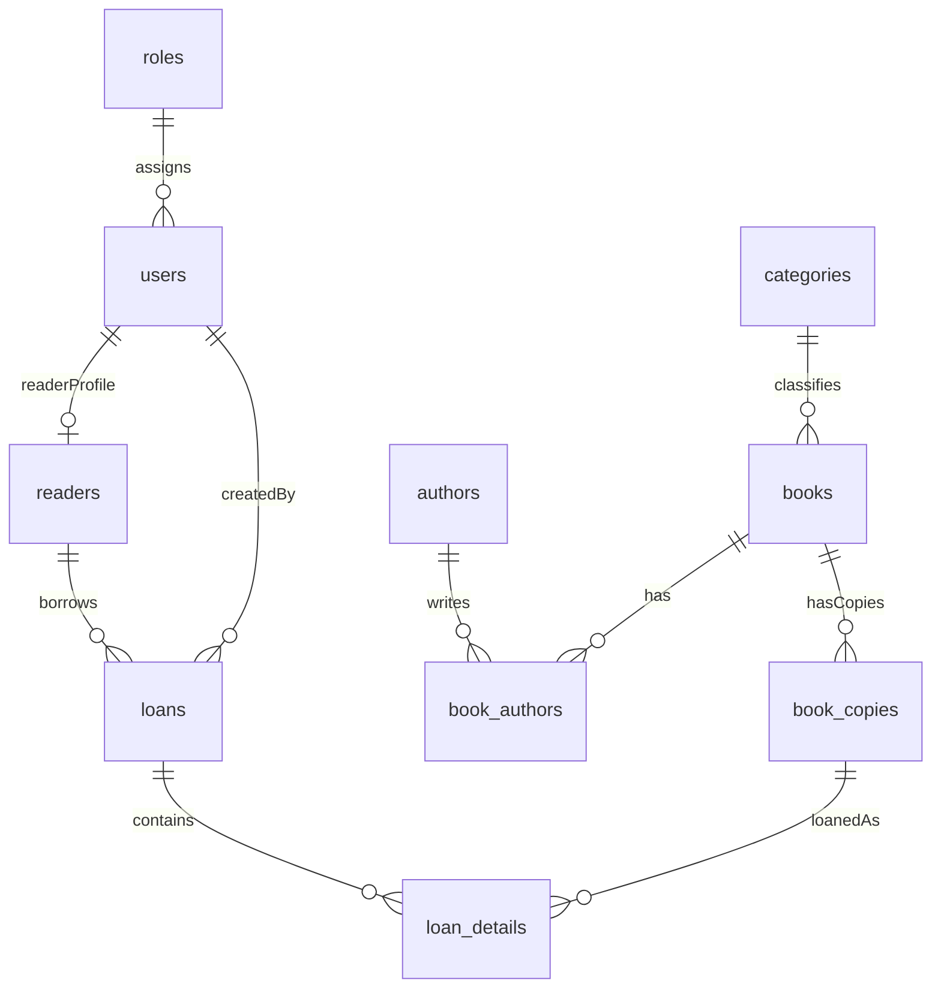

# SOFTWARE REQUIREMENTS SPECIFICATION

# Hệ thống Quản lý Thư viện — phiên bản 1.1

**Phạm vi:** MVP — đồ án sinh viên  
**Ngày:** 2026-10-14  
**Cơ sở:** tiến hóa từ `docs/SRS_Quan_Ly_Thu_Vien_v1.0.docx` (hướng 2: giữ khung v1.0, bổ sung mục đồ án còn thiếu, chốt nghiệp vụ đã thống nhất)

| Thông tin | Giá trị |
| --- | --- |
| Tên dự án | Library Management System |
| Mục đích tài liệu | Đặc tả yêu cầu phần mềm cho website quản lý thư viện |
| Backend | Java Servlet 4.0 (`javax.servlet`), JDBC |
| Frontend | JSP, HTML, CSS, Bootstrap 5, JavaScript |
| Cơ sở dữ liệu | MySQL 8.0 |
| Kiến trúc đề xuất | MVC + Service + DAO + JDBC |
| Máy chủ ứng dụng | Apache Tomcat 9.0 |
| JDK | 17 |
| Người dùng chính | Admin, Librarian, Reader |

## Lịch sử phiên bản

| Phiên bản | Ngày | Thay đổi |
| --- | --- | --- |
| 1.0 | trước 2026-10-14 | Bản SRS ban đầu: phạm vi MVP, FR/NFR, ma trận quyền, bảng UC, tiêu chí nghiệm thu |
| 1.1 | 2026-10-14 | Bổ sung glossary, giả định/ràng buộc, môi trường; luồng đăng ký/duyệt/tạo hộ độc giả; cấu hình Admin; đổi mật khẩu; trạng thái thẻ/bản sách/phiếu; UC chi tiết; ERD; danh sách màn hình; ma trận truy vết. **Loại tiền phạt khỏi MVP.** |

---

## 1. Giới thiệu dự án

### 1.1. Mục đích

Xây dựng website hỗ trợ quản lý hoạt động thư viện: quản lý sách, độc giả, mượn/trả, theo dõi quá hạn và thống kê cơ bản. Hệ thống thay thế sổ sách/bảng tính, giảm sai sót, theo dõi tình trạng từng bản sách và cho phép tra cứu nhanh.

Tài liệu này là baseline yêu cầu cho phiên bản MVP. Thiết kế vật lý (sơ đồ lớp, cấu trúc package Java) không thuộc SRS; sẽ nằm ở kế hoạch triển khai.

### 1.2. Phạm vi hệ thống (MVP)

Trong phạm vi:

- Đăng nhập, đăng xuất, phân quyền, đổi mật khẩu, hết hạn phiên.
- Độc giả tự đăng ký; thủ thư/Admin duyệt hoặc từ chối thẻ; tạo hộ hồ sơ tại quầy kèm tài khoản.
- Quản lý đầu sách, bản sách, tác giả, thể loại.
- Quản lý hồ sơ độc giả (sửa, khóa/mở khóa thẻ).
- Lập phiếu mượn nhiều bản, trả từng bản, theo dõi quá hạn.
- Tra cứu sách và xem thông tin mượn/trả của chính độc giả.
- Dashboard và báo cáo cơ bản.
- Admin cấu hình số sách tối đa đang mượn và số ngày mượn mặc định.

Ngoài phạm vi: xem mục 10.

### 1.3. Đối tượng sử dụng

| Vai trò | Mô tả |
| --- | --- |
| Admin — Quản trị viên | Quản lý tài khoản nhân viên, phân quyền (gán vai trò), cấu hình hệ thống, toàn bộ nghiệp vụ thư viện. |
| Librarian — Thủ thư | Quản lý sách, độc giả, duyệt thẻ, giao dịch mượn/trả, xem báo cáo nghiệp vụ. Không quản lý tài khoản Admin/Librarian, không sửa cấu hình hệ thống. |
| Reader — Độc giả | Tự đăng ký; sau khi đăng nhập: tra cứu sách, xem hồ sơ, sách đang mượn và lịch sử của mình. Không tự lập phiếu mượn/trả trên web. |

### 1.4. Định nghĩa và từ viết tắt

| Thuật ngữ | Nghĩa trong tài liệu này |
| --- | --- |
| Đầu sách (`books`) | Ấn phẩm logic: tên, ISBN, thể loại, NXB, năm XB, danh sách tác giả. |
| Bản sách (`book_copies`) | Một bản vật lý của đầu sách, có mã riêng và trạng thái riêng. |
| Thẻ độc giả | Hồ sơ `readers` gắn 1–1 với tài khoản vai trò Reader; có trạng thái PENDING / ACTIVE / LOCKED / REJECTED. |
| Phiếu mượn (`loans`) | Một giao dịch mượn của một độc giả tại một thời điểm, chứa một hoặc nhiều chi tiết bản sách. |
| Chi tiết mượn (`loan_details`) | Một bản sách trong phiếu; lưu hạn trả (snapshot) và ngày trả thực tế nếu đã trả. |
| Quá hạn | Chi tiết mượn chưa trả và ngày hiện tại (theo `Asia/Ho_Chi_Minh`) **sau** `due_date`. Trả đúng ngày hạn vẫn không quá hạn. |
| MVP | Minimum Viable Product — phạm vi phiên bản 1.1 đủ để trình diễn đồ án. |
| FR / NFR / UC | Functional Requirement / Non-functional Requirement / Use Case. |
| IDOR | Insecure Direct Object Reference — đổi ID trên URL để xem dữ liệu người khác. |
| Session | Phiên đăng nhập phía máy chủ (HttpSession). |

### 1.5. Giả định

- Thư viện vận hành một cơ sở (không đa chi nhánh).
- Thủ thư thông báo kết quả duyệt thẻ cho độc giả bằng kênh ngoài hệ thống (trực tiếp/điện thoại). Hệ thống không gửi email/SMS.
- Ngày nghiệp vụ (mượn, hạn trả, trả, quá hạn) là **ngày dương lịch**, múi giờ `Asia/Ho_Chi_Minh`, không dùng giờ phút.
- Có ít nhất một tài khoản Admin được tạo sẵn khi cài đặt (seed) để đăng nhập lần đầu.
- Dữ liệu mẫu phục vụ demo được cung cấp kèm hướng dẫn cài đặt.

### 1.6. Ràng buộc

- Công nghệ đã chọn: Java Servlet + JSP + JDBC + MySQL; không dùng framework MVC nặng (Spring) trong MVP.
- Không tích hợp cổng thanh toán, email, RFID, kho nhiều chi nhánh.
- Môi trường mục tiêu là máy demo/đồ án, không phải production.

### 1.7. Môi trường vận hành

| Thành phần | Yêu cầu |
| --- | --- |
| JDK | 17 |
| Servlet/JSP | Servlet 4.0, JSP 2.3 trên Apache Tomcat 9.0 |
| DBMS | MySQL 8.0, charset `utf8mb4` |
| Trình duyệt | Google Chrome, Mozilla Firefox, Microsoft Edge — phiên bản ổn định mới nhất tại thời điểm nghiệm thu |
| Giao diện | Tiếng Việt, encoding UTF-8 |

---

## 2. Yêu cầu chức năng

Quy ước ưu tiên: **Must** = bắt buộc trong MVP; **Should** = nên có nếu kịp, không chặn nghiệm thu lõi.

### 2.1. Quản lý tài khoản và xác thực

| Mã | Yêu cầu | Ưu tiên |
| --- | --- | --- |
| FR-AUTH-01 | Người dùng đăng nhập bằng username và password. | Must |
| FR-AUTH-02 | Người dùng có thể đăng xuất. | Must |
| FR-AUTH-03 | Kiểm tra tài khoản/mật khẩu trước khi tạo phiên. | Must |
| FR-AUTH-04 | Phân quyền theo đúng một vai trò: Admin, Librarian hoặc Reader. | Must |
| FR-AUTH-05 | Admin tạo, sửa, khóa và mở khóa tài khoản Admin và Librarian. Admin không dùng màn hình này để tạo độc giả (độc giả theo mục 2.4). | Must |
| FR-AUTH-06 | Từ chối truy cập chức năng khi không đủ quyền. Kiểm tra trên backend. | Must |
| FR-AUTH-07 | Lưu mật khẩu bằng BCrypt; không lưu plaintext. | Must |
| FR-AUTH-08 | Người dùng đã đăng nhập đổi được mật khẩu của chính mình (mật khẩu hiện tại + mật khẩu mới + xác nhận). | Must |
| FR-AUTH-09 | Phiên hết hạn sau 30 phút không hoạt động; đăng xuất hủy session. | Must |
| FR-AUTH-10 | Độc giả tự đăng ký tài khoản (username, password, họ tên, email, số điện thoại). Hệ thống tạo `users` (role Reader) và `readers` (PENDING) trong cùng transaction. | Must |

Quy tắc:

- Tài khoản Admin/Librarian bị khóa (`users.locked`) không đăng nhập được. Thông báo chung, không tiết lộ username có tồn tại hay mật khẩu sai (NFR-08).
- Reader trạng thái REJECTED không đăng nhập được. Thông báo: tài khoản chưa được duyệt hoặc đã bị từ chối.
- Reader PENDING, ACTIVE hoặc LOCKED (thẻ) đăng nhập được. MVP **không** dùng `users.locked` cho tài khoản Reader; chặn đăng nhập độc giả chỉ qua trạng thái REJECTED.
- Username unique, 4–32 ký tự `[a-zA-Z0-9._]`. Email unique, đúng định dạng. Mật khẩu tối thiểu 8 ký tự.
- Không có chức năng quên mật khẩu (phụ thuộc email — ngoài phạm vi).
- Người dùng không tự đổi vai trò. Không leo quyền qua thao tác client.

### 2.2. Quản lý sách

| Mã | Yêu cầu | Ưu tiên |
| --- | --- | --- |
| FR-BOOK-01 | Thủ thư/Admin thêm đầu sách. | Must |
| FR-BOOK-02 | Thủ thư/Admin cập nhật thông tin đầu sách. | Must |
| FR-BOOK-03 | Thủ thư/Admin ngừng hoặc mở lại lưu hành đầu sách. | Must |
| FR-BOOK-04 | Lưu tên, ISBN (tùy chọn), tác giả (một hoặc nhiều), đúng một thể loại, nhà xuất bản, năm xuất bản. | Must |
| FR-BOOK-05 | Quản lý từng bản sách vật lý: mã định danh riêng, thêm bản, ngừng lưu hành bản. | Must |
| FR-BOOK-06 | Tìm sách theo tên, tác giả hoặc ISBN. | Must |
| FR-BOOK-07 | Lọc sách theo thể loại và tình trạng còn bản sẵn sàng. | Should |
| FR-BOOK-08 | Danh sách sách hỗ trợ phân trang. | Should |

Quy tắc:

- ISBN được phép trống. Nếu có giá trị: unique trên toàn bảng `books`; cho phép gạch nối khi nhập; lưu dạng chuẩn (bỏ gạch). ISBN-10: 9 chữ số + (chữ số hoặc `X`); ISBN-13: 13 chữ số.
- Không xóa vật lý đầu sách hoặc bản sách đã từng phát sinh `loan_details`. Bản chưa từng mượn và đầu sách chưa từng có bản đã mượn: cho phép xóa.
- Đầu sách ngừng lưu hành: không tạo phiếu mượn mới cho mọi bản của đầu sách đó. Bản đang mượn vẫn trả được.
- Bản sách `WITHDRAWN` hoặc `BORROWED` không dùng để mượn mới.
- Không chuyển bản đang `BORROWED` sang `WITHDRAWN`. Ngừng lưu hành bản chỉ khi trạng thái đang là `AVAILABLE`.
- Mã bản sách do thủ thư nhập, unique, bắt buộc.

Trạng thái bản sách: `AVAILABLE` | `BORROWED` | `WITHDRAWN`.  
Trạng thái đầu sách: `ACTIVE` | `WITHDRAWN`.

### 2.3. Quản lý tác giả và thể loại

| Mã | Yêu cầu | Ưu tiên |
| --- | --- | --- |
| FR-CAT-01 | Thủ thư/Admin thêm, sửa thể loại. | Must |
| FR-CAT-02 | Thủ thư/Admin thêm, sửa tác giả. | Must |
| FR-CAT-03 | Một đầu sách liên kết với một hoặc nhiều tác giả (`book_authors`). | Must |
| FR-CAT-04 | Không xóa thể loại/tác giả đang được sách sử dụng. | Must |

Nhà xuất bản là trường trên đầu sách, không có module NXB riêng.

Một đầu sách thuộc **đúng một** thể loại.

### 2.4. Quản lý độc giả

| Mã | Yêu cầu | Ưu tiên |
| --- | --- | --- |
| FR-READER-01 | Thủ thư/Admin tạo hộ hồ sơ độc giả tại quầy: họ tên, email, điện thoại, username, mật khẩu ban đầu. Tạo `users` + `readers` trạng thái ACTIVE trong một transaction. | Must |
| FR-READER-02 | Thủ thư/Admin cập nhật thông tin hồ sơ độc giả (họ tên, email, điện thoại). Không đổi username. | Must |
| FR-READER-03 | Thủ thư/Admin khóa thẻ ACTIVE → LOCKED và mở khóa LOCKED → ACTIVE. | Must |
| FR-READER-04 | Lưu mã độc giả (sinh tự động, unique), họ tên, email, số điện thoại. | Must |
| FR-READER-05 | Tìm độc giả theo mã hoặc họ tên. | Must |
| FR-READER-06 | Độc giả xem hồ sơ, trạng thái thẻ, sách đang mượn và lịch sử của mình. | Must |
| FR-READER-07 | Độc giả tự đăng ký: hồ sơ PENDING; được đăng nhập để tra cứu; không được mượn. | Must |
| FR-READER-08 | Thủ thư/Admin duyệt PENDING → ACTIVE. | Must |
| FR-READER-09 | Thủ thư/Admin từ chối PENDING → REJECTED. Có thể chuyển REJECTED → ACTIVE (duyệt lại) hoặc REJECTED → PENDING. | Must |
| FR-READER-10 | Hiển thị hàng đợi hồ sơ PENDING để duyệt. | Must |

Trạng thái thẻ:

```text
PENDING --duyệt--> ACTIVE --khóa--> LOCKED
    |                 ^               |
    +--từ chối--> REJECTED            +--mở khóa--> ACTIVE
                     |
                     +--duyệt lại--> ACTIVE
                     +--mở lại--> PENDING
```

Quy tắc mượn theo thẻ:

- Chỉ thẻ `ACTIVE` được lập phiếu mượn mới.
- `LOCKED` và `PENDING`: đăng nhập được, không mượn mới; lịch sử giữ nguyên.
- `REJECTED`: không đăng nhập.
- Không xóa vật lý độc giả đã có phiếu mượn.

Mã độc giả: tiền tố `DG` + 6 chữ số, tăng dần (`DG000001`, …).

### 2.5. Quản lý mượn sách

| Mã | Yêu cầu | Ưu tiên |
| --- | --- | --- |
| FR-LOAN-01 | Thủ thư hoặc Admin tạo phiếu mượn cho độc giả thẻ ACTIVE. | Must |
| FR-LOAN-02 | Một phiếu chứa một hoặc nhiều bản sách. | Must |
| FR-LOAN-03 | Ghi ngày mượn = ngày hiện tại; hạn trả mỗi chi tiết = ngày mượn + `loan_period_days` (giá trị cấu hình **tại thời điểm lập phiếu**). | Must |
| FR-LOAN-04 | Chỉ cho mượn bản `AVAILABLE` thuộc đầu sách `ACTIVE`. | Must |
| FR-LOAN-05 | Kiểm tra thẻ ACTIVE và số bản đang mượn (chưa trả) + số bản trên phiếu mới ≤ `max_borrow_count`. | Must |
| FR-LOAN-06 | Sau khi thành công: mỗi bản → `BORROWED`; phiếu → `OPEN`. | Must |
| FR-LOAN-07 | Tra cứu phiếu theo mã phiếu hoặc độc giả. | Must |

Quy tắc:

- Số cuốn tối đa và số ngày mượn lấy từ `system_settings`, không hardcode trong nghiệp vụ (giá trị mặc định lúc cài đặt: 5 cuốn, 14 ngày).
- Đổi cấu hình **không** sửa `due_date` của chi tiết đã tạo.
- Tạo phiếu + chi tiết + đổi trạng thái bản sách trong **một** transaction. Nếu một bản không hợp lệ, toàn bộ phiếu thất bại.
- Hai yêu cầu mượn cùng một bản: chỉ một giao dịch thành công; giao dịch kia báo bản không còn sẵn sàng.
- Mã phiếu sinh tự động, unique (`PM` + 6 chữ số).

Đếm sách đang mượn: số `loan_details` có `status = BORROWED` của độc giả, mọi phiếu.

### 2.6. Quản lý trả sách và quá hạn

| Mã | Yêu cầu | Ưu tiên |
| --- | --- | --- |
| FR-RETURN-01 | Thủ thư/Admin xác nhận trả từng bản trên phiếu `OPEN`. | Must |
| FR-RETURN-02 | Ghi `returned_at` = ngày hiện tại. | Must |
| FR-RETURN-03 | Bản sách đã trả luôn chuyển về `AVAILABLE`. | Must |
| FR-RETURN-04 | Đánh dấu chi tiết quá hạn khi ngày hiện tại > `due_date` và chưa trả. | Must |
| FR-RETURN-05 | *(Không thuộc MVP — xem mục 10.)* | — |
| FR-RETURN-06 | Danh sách bản chưa trả và danh sách quá hạn. | Must |
| FR-RETURN-07 | Không trả trùng chi tiết đã `RETURNED`. | Must |

Quy tắc:

- Trả từng phần: phiếu vẫn `OPEN` khi còn chi tiết `BORROWED`; khi hết → `COMPLETED`.
- Không tính tiền phạt, không lưu khoản phạt, không ghi nhận thu tiền.
- Quá hạn chỉ để hiển thị/lọc/báo cáo.

### 2.7. Tra cứu dành cho độc giả

| Mã | Yêu cầu | Ưu tiên |
| --- | --- | --- |
| FR-SEARCH-01 | Độc giả đã đăng nhập xem danh sách đầu sách đang lưu hành. | Must |
| FR-SEARCH-02 | Tìm theo tên, tác giả hoặc ISBN. | Must |
| FR-SEARCH-03 | Xem chi tiết đầu sách (thông tin + số bản `AVAILABLE`). | Must |
| FR-SEARCH-04 | Số bản sẵn sàng = đếm `book_copies` trạng thái `AVAILABLE` của đầu sách `ACTIVE`. | Must |
| FR-SEARCH-05 | Xem các chi tiết đang `BORROWED` của mình và hạn trả. | Must |
| FR-SEARCH-06 | Xem lịch sử mượn/trả của mình. | Must |

Độc giả không tự xác nhận mượn/trả trên web. Độc giả chưa đăng nhập chỉ tới trang đăng nhập/đăng ký.

### 2.8. Dashboard và báo cáo

| Mã | Yêu cầu | Ưu tiên |
| --- | --- | --- |
| FR-REPORT-01 | Tổng số đầu sách và tổng số bản sách. | Must |
| FR-REPORT-02 | Tổng số độc giả trạng thái ACTIVE. | Must |
| FR-REPORT-03 | Số bản đang được mượn (`book_copies.status = BORROWED`). | Must |
| FR-REPORT-04 | Số chi tiết quá hạn chưa trả. | Must |
| FR-REPORT-05 | Thống kê đầu sách được mượn nhiều nhất (đếm `loan_details`). | Should |
| FR-REPORT-06 | Lọc báo cáo theo khoảng ngày mượn. | Should |

Số liệu tính từ database, không nhập tay. Reader không xem dashboard.

### 2.9. Cấu hình hệ thống

| Mã | Yêu cầu | Ưu tiên |
| --- | --- | --- |
| FR-CFG-01 | Admin xem và sửa `max_borrow_count` (số nguyên ≥ 1). | Must |
| FR-CFG-02 | Admin xem và sửa `loan_period_days` (số nguyên ≥ 1). | Must |
| FR-CFG-03 | Giá trị mới chỉ áp dụng cho phiếu mượn tạo sau thời điểm lưu. | Must |

Librarian và Reader không truy cập màn hình cấu hình.

---

## 3. Ma trận phân quyền

| Chức năng | Admin | Librarian | Reader |
| --- | --- | --- | --- |
| Quản lý tài khoản Admin/Librarian | Đầy đủ | Không | Không |
| Đăng ký tài khoản Reader | Không (dùng luồng tạo hộ hoặc độc giả tự ký) | Không | Có (tự đăng ký) |
| Duyệt / từ chối / khóa thẻ độc giả | Có | Có | Không |
| Tạo hộ độc giả tại quầy | Có | Có | Không |
| Hồ sơ cá nhân / đổi mật khẩu | Của mình | Của mình | Của mình |
| Quản lý sách, tác giả, thể loại | Đầy đủ | Đầy đủ | Chỉ xem đầu sách đang lưu hành |
| Tạo phiếu mượn | Có | Có | Không |
| Xác nhận trả sách | Có | Có | Không |
| Xem lịch sử giao dịch | Tất cả | Tất cả (phục vụ quầy) | Chỉ của mình |
| Dashboard / báo cáo | Có | Có | Không |
| Cấu hình hệ thống | Có | Không | Không |

Bảo mật đi kèm:

- Kiểm tra vai trò trên servlet/filter, không chỉ ẩn nút giao diện.
- Reader không đổi `readerId` / `loanId` trên URL để xem dữ liệu người khác (so khớp với `readers.user_id` của session).
- Không tự nâng quyền.
- Mọi truy vấn dùng `PreparedStatement`.
- Mọi dữ liệu đầu vào kiểm tra phía server.

---

## 4. Yêu cầu phi chức năng

| Mã | Yêu cầu |
| --- | --- |
| NFR-01 | Chạy đúng trên Chrome, Firefox, Edge (bản ổn định mới nhất lúc nghiệm thu), viewport tối thiểu 1280×720 cho màn thủ thư; Reader dùng được trên viewport 375px (bố cục xếp chồng, không vỡ form). |
| NFR-02 | Toàn bộ giao diện tiếng Việt, UTF-8. |
| NFR-03 | Thao tác CRUD thông thường hoàn thành trong khoảng 2 giây trên máy demo (cùng máy với Tomcat + MySQL, dataset mẫu ≤ 1.000 đầu sách, ≤ 5.000 bản, ≤ 500 độc giả). Đây là tiêu chí kiểm thử đồ án, không phải cam kết production. |
| NFR-04 | Hash mật khẩu BCrypt (cost factor ≥ 10). |
| NFR-05 | Truy vấn tham số hóa (`PreparedStatement`); không nối chuỗi SQL từ input. |
| NFR-06 | Mượn và trả chạy trong transaction; lỗi giữa chừng rollback; hai mượn cùng bản: đúng một thành công. |
| NFR-07 | Phân quyền kiểm tra backend (filter/servlet). |
| NFR-08 | Thông báo lỗi rõ, tiếng Việt; không trả stack trace hay thông tin kết nối DB ra giao diện. |
| NFR-09 | Thông tin kết nối DB (host, port, name, user, password) nằm ngoài mã nguồn (file cấu hình không commit mật khẩu thật). |
| NFR-10 | Có README: cài JDK/Tomcat/MySQL, import schema + seed, tạo Admin mặc định, chạy ứng dụng. |
| NFR-11 | Ngày nghiệp vụ theo `Asia/Ho_Chi_Minh`. |
| NFR-12 | Session idle timeout 30 phút. |

---

## 5. Yêu cầu dữ liệu

### 5.1. Thực thể

| Bảng | Mục đích | Ghi chú bắt buộc |
| --- | --- | --- |
| `roles` | Admin, Librarian, Reader | Seed 3 dòng. |
| `users` | Tài khoản đăng nhập | `username` unique, `password_hash`, `role_id`, `locked`, timestamps. |
| `readers` | Hồ sơ / thẻ độc giả | `user_id` unique (1–1 với user Reader), `code` unique, `status`, họ tên, email unique, điện thoại. |
| `categories` | Thể loại | Tên unique. |
| `authors` | Tác giả | Tên bắt buộc. |
| `books` | Đầu sách | `category_id`, `isbn` unique nullable, `status`, NXB, năm XB. |
| `book_authors` | N–N sách–tác giả | PK kép (`book_id`, `author_id`). |
| `book_copies` | Bản vật lý | `code` unique, `book_id`, `status`. |
| `loans` | Phiếu mượn | `code` unique, `reader_id`, `created_by_user_id`, `borrowed_on`, `status`. |
| `loan_details` | Từng bản trên phiếu | `loan_id`, `copy_id`, `due_date`, `returned_at` nullable, `status`. Một bản không thể nằm trên hai chi tiết `BORROWED` cùng lúc. |
| `system_settings` | Cấu hình | Khóa `max_borrow_count`, `loan_period_days` (kiểu số nguyên). |

Không có bảng `fines` trong v1.1.

Mỗi bảng có khóa chính. Quan hệ dùng khóa ngoại. Lịch sử mượn/trả giữ lại khi sách/độc giả ngừng hoạt động.

### 5.2. Quan hệ



- `roles` 1–N `users`
- `users` 1–0..1 `readers` (chỉ role Reader)
- `books` N–N `authors` qua `book_authors`
- `categories` 1–N `books`
- `books` 1–N `book_copies`
- `readers` 1–N `loans`
- `loans` 1–N `loan_details`
- `loan_details` N–1 `book_copies`
- `loans.created_by_user_id` N–1 `users` (thủ thư/Admin lập phiếu)

### 5.3. Enum trạng thái (giá trị duy nhất, không đa nghĩa)

| Thực thể | Giá trị | Nghĩa |
| --- | --- | --- |
| `readers.status` | PENDING | Chờ duyệt; đăng nhập được; không mượn. |
| | ACTIVE | Được mượn (nếu user không bị khóa). |
| | LOCKED | Thẻ khóa; đăng nhập được; không mượn. |
| | REJECTED | Từ chối; không đăng nhập. |
| `books.status` | ACTIVE | Được mượn (nếu bản AVAILABLE). |
| | WITHDRAWN | Ngừng lưu hành đầu sách. |
| `book_copies.status` | AVAILABLE | Sẵn sàng cho mượn. |
| | BORROWED | Đang được mượn. |
| | WITHDRAWN | Ngừng lưu hành bản. |
| `loans.status` | OPEN | Còn ít nhất một chi tiết BORROWED. |
| | COMPLETED | Mọi chi tiết RETURNED. |
| `loan_details.status` | BORROWED | Chưa trả. |
| | RETURNED | Đã trả. |

Khóa tài khoản nhân viên (`users.locked = true`, chỉ Admin/Librarian) khác khóa thẻ độc giả (`readers.status = LOCKED`). Khóa thẻ không chặn đăng nhập; khóa tài khoản nhân viên thì chặn đăng nhập. Độc giả bị chặn đăng nhập khi `REJECTED`.

---

## 6. Use case

### 6.1. Danh sách

| Mã | Use case | Tác nhân | FR chính |
| --- | --- | --- | --- |
| UC-01 | Đăng nhập | Admin, Librarian, Reader | FR-AUTH-01, 03, 09 |
| UC-02 | Đăng xuất | Admin, Librarian, Reader | FR-AUTH-02 |
| UC-03 | Đổi mật khẩu | Admin, Librarian, Reader | FR-AUTH-08 |
| UC-04 | Quản lý tài khoản nhân viên | Admin | FR-AUTH-05 |
| UC-05 | Đăng ký tài khoản độc giả | Reader (khách) | FR-AUTH-10, FR-READER-07 |
| UC-06 | Duyệt / từ chối thẻ | Admin, Librarian | FR-READER-08, 09, 10 |
| UC-07 | Tạo độc giả tại quầy | Admin, Librarian | FR-READER-01 |
| UC-08 | Cập nhật / khóa thẻ độc giả | Admin, Librarian | FR-READER-02, 03, 05 |
| UC-09 | Quản lý thể loại và tác giả | Admin, Librarian | FR-CAT-01..04 |
| UC-10 | Quản lý đầu sách và bản sách | Admin, Librarian | FR-BOOK-01..05 |
| UC-11 | Lập phiếu mượn | Admin, Librarian | FR-LOAN-01..06 |
| UC-12 | Xác nhận trả sách | Admin, Librarian | FR-RETURN-01..03, 07 |
| UC-13 | Theo dõi quá hạn | Admin, Librarian | FR-RETURN-04, 06 |
| UC-14 | Tra cứu sách | Reader | FR-SEARCH-01..04 |
| UC-15 | Xem sách đang mượn và lịch sử | Reader | FR-SEARCH-05, 06, FR-READER-06 |
| UC-16 | Xem dashboard / báo cáo | Admin, Librarian | FR-REPORT-01..06 |
| UC-17 | Cấu hình hệ thống | Admin | FR-CFG-01..03 |

### 6.2. Đặc tả use case lõi

Mỗi UC dùng chung mẫu: tác nhân, tiền điều kiện, hậu điều kiện, luồng chính, ngoại lệ.

#### UC-01 Đăng nhập

- **Tác nhân:** Admin, Librarian, Reader  
- **Tiền điều kiện:** Chưa có session hợp lệ.  
- **Hậu điều kiện thành công:** Session chứa `userId`, `role`; timeout 30 phút.  
- **Luồng chính:**
  1. Người dùng mở trang đăng nhập, nhập username và password.
  2. Hệ thống tìm user, kiểm tra không `locked`, so khớp BCrypt.
  3. Nếu role Reader: đọc `readers.status`; nếu REJECTED thì thất bại.
  4. Tạo session, chuyển dashboard (Admin/Librarian) hoặc trang tra cứu (Reader).
- **Ngoại lệ:** Sai username/password, tài khoản khóa, Reader REJECTED, thiếu trường → ở lại form, thông báo tiếng Việt, không tạo session.

#### UC-03 Đổi mật khẩu

- **Tiền điều kiện:** Đã đăng nhập.  
- **Luồng chính:** Nhập mật khẩu hiện tại, mật khẩu mới, xác nhận → kiểm tra khớp hiện tại, mật khẩu mới ≥ 8 ký tự và trùng xác nhận → cập nhật hash.  
- **Ngoại lệ:** Sai mật khẩu hiện tại; mật khẩu mới không hợp lệ; hai lần nhập không khớp.

#### UC-05 Đăng ký tài khoản độc giả

- **Tác nhân:** Khách chưa đăng nhập.  
- **Hậu điều kiện thành công:** Có `users` (Reader, không khóa) và `readers` (PENDING, mã `DGxxxxxx`); chưa có phiếu mượn.  
- **Luồng chính:**
  1. Khách mở form đăng ký: username, password, xác nhận password, họ tên, email, điện thoại.
  2. Server kiểm tra định dạng, unique username/email, password ≥ 8 và khớp.
  3. Transaction: insert user + reader PENDING, sinh mã độc giả.
  4. Chuyển trang đăng nhập kèm thông báo: tài khoản chờ duyệt, tra cứu được sau khi đăng nhập, mượn sách sau khi thủ thư duyệt.
- **Ngoại lệ:** Trùng username/email; thiếu trường; lỗi DB → rollback, không tạo nửa user/nửa reader.

#### UC-06 Duyệt / từ chối thẻ

- **Tiền điều kiện:** Admin/Librarian đã đăng nhập. Có hồ sơ PENDING (hoặc REJECTED nếu duyệt lại).  
- **Luồng chính (duyệt):** Chọn hồ sơ PENDING → xác nhận duyệt → `status = ACTIVE`.  
- **Luồng thay thế (từ chối):** PENDING → REJECTED.  
- **Luồng thay thế (duyệt lại):** REJECTED → ACTIVE.  
- **Ngoại lệ:** Hồ sơ không còn PENDING (đã được người khác duyệt) → thông báo làm mới danh sách.

#### UC-07 Tạo độc giả tại quầy

- **Luồng chính:** Nhân viên nhập họ tên, email, điện thoại, username, mật khẩu ban đầu → unique + định dạng → transaction tạo user Reader và reader ACTIVE. Hiện mã độc giả cho nhân viên.  
- **Ngoại lệ:** Trùng email/username. Độc giả này mượn được ngay (thẻ ACTIVE).

#### UC-11 Lập phiếu mượn

- **Tiền điều kiện:** Admin/Librarian đã đăng nhập.  
- **Hậu điều kiện thành công:** Phiếu `OPEN`; mỗi chi tiết `BORROWED` có `due_date`; mỗi bản `BORROWED`.  
- **Luồng chính:**
  1. Chọn độc giả (tìm mã/tên). Hệ thống từ chối nếu thẻ không ACTIVE hoặc user bị khóa.
  2. Thêm từng mã bản sách. Mỗi bản phải `AVAILABLE`, đầu sách `ACTIVE`, chưa nằm trên phiếu đang soạn.
  3. Hệ thống hiển thị số đang mượn, hạn mức `max_borrow_count`, hạn trả dự kiến.
  4. Xác nhận. Transaction: kiểm tra lại trạng thái bản + hạn mức; insert `loans` + `loan_details`; cập nhật bản → `BORROWED`.
- **Ngoại lệ:**
  - Thẻ không ACTIVE / user khóa.
  - Vượt hạn mức.
  - Bản vừa bị mượn (đua tranh) hoặc WITHDRAWN / đầu sách WITHDRAWN.
  - Phiếu không có bản nào.
  - Mọi thất bại: rollback, không đổi trạng thái bản.

#### UC-12 Xác nhận trả sách

- **Luồng chính:** Tìm phiếu OPEN hoặc độc giả đang mượn → chọn từng chi tiết BORROWED → xác nhận trả → `returned_at` = hôm nay, chi tiết RETURNED, bản AVAILABLE. Nếu không còn chi tiết BORROWED: phiếu COMPLETED.  
- **Ngoại lệ:** Chi tiết đã RETURNED; phiếu không tồn tại; lỗi transaction → rollback chi tiết đang xử lý.

#### UC-13 Theo dõi quá hạn

- **Luồng chính:** Mở danh sách chi tiết BORROWED có `due_date` < hôm nay. Hiển thị độc giả, mã bản, hạn trả, số ngày quá hạn (= hôm nay − `due_date` theo ngày lịch).  
- **Ghi chú:** Không tính tiền.

#### UC-17 Cấu hình hệ thống

- **Tiền điều kiện:** Admin đã đăng nhập.  
- **Luồng chính:** Xem hai giá trị hiện tại; sửa số nguyên ≥ 1; lưu. Phiếu mới dùng giá trị mới.  
- **Ngoại lệ:** Không phải số nguyên / < 1 → không lưu. Librarian gọi URL cấu hình → 403.

### 6.3. Đặc tả use case còn lại (rút gọn)

| UC | Luồng chính | Ngoại lệ chính |
| --- | --- | --- |
| UC-02 | Chọn đăng xuất → invalidate session → trang login. | Session đã hết hạn: vẫn về login. |
| UC-04 | Admin tạo/sửa/khóa/mở khóa tài khoản Admin/Librarian; gán đúng một role. Không xóa vật lý user — chỉ khóa. | Không tự khóa chính mình; username trùng. |
| UC-08 | Tìm độc giả; sửa họ tên/email/SĐT; khóa/mở khóa thẻ ACTIVE ↔ LOCKED. | Email trùng; không khóa thẻ REJECTED (phải duyệt lại theo UC-06). |
| UC-09 | CRUD thể loại/tác giả. | Xóa khi đang gắn sách → từ chối. |
| UC-10 | CRUD đầu sách (nhiều tác giả, một thể loại); thêm bản; ngừng lưu hành đầu sách/bản. Tìm/lọc/phân trang theo FR-BOOK-06..08. | ISBN trùng; xóa khi đã có lịch sử mượn; mã bản trùng; bản `BORROWED` không chuyển `WITHDRAWN`. |
| UC-14 | Reader đăng nhập; danh sách/tìm/chi tiết; số bản AVAILABLE. | Chưa đăng nhập → login. |
| UC-15 | Reader xem chi tiết BORROWED của mình và lịch sử mọi phiếu của `readers.user_id` = session. | Truy cập ID người khác → 403. |
| UC-16 | Dashboard đếm theo mục 2.8; Should: top sách, lọc khoảng ngày. | Reader → 403. |

---

## 7. Danh sách màn hình

| Mã | Màn hình | Vai trò | Mục đích |
| --- | --- | --- | --- |
| UI-01 | Đăng nhập | Công khai | UC-01 |
| UI-02 | Đăng ký độc giả | Công khai | UC-05 |
| UI-03 | Đổi mật khẩu | Mọi user đăng nhập | UC-03 |
| UI-04 | Dashboard | Admin, Librarian | UC-16 |
| UI-05 | Tài khoản nhân viên | Admin | UC-04 |
| UI-06 | Cấu hình hệ thống | Admin | UC-17 |
| UI-07 | Thể loại / Tác giả | Admin, Librarian | UC-09 |
| UI-08 | Danh sách / form đầu sách | Admin, Librarian | UC-10 |
| UI-09 | Bản sách của một đầu sách | Admin, Librarian | UC-10 |
| UI-10 | Hàng đợi duyệt thẻ | Admin, Librarian | UC-06 |
| UI-11 | Danh sách / form độc giả | Admin, Librarian | UC-07, UC-08 |
| UI-12 | Lập phiếu mượn | Admin, Librarian | UC-11 |
| UI-13 | Trả sách / chi tiết phiếu | Admin, Librarian | UC-12 |
| UI-14 | Danh sách quá hạn | Admin, Librarian | UC-13 |
| UI-15 | Tra cứu sách | Reader | UC-14 |
| UI-16 | Chi tiết đầu sách | Reader | UC-14 |
| UI-17 | Sách đang mượn / lịch sử / hồ sơ | Reader | UC-15 |

Bố cục: Bootstrap 5, tiếng Việt, menu theo vai trò. Wireframe pixel-level không thuộc SRS; đủ để triển khai JSP theo danh sách trên.

---

## 8. Ma trận truy vết nghiệm thu

| Tiêu chí nghiệm thu | FR | UC |
| --- | --- | --- |
| Ba vai trò đăng nhập đúng phạm vi quyền | FR-AUTH-01..06 | UC-01, ma trận mục 3 |
| Đổi mật khẩu được; quên mật khẩu không có | FR-AUTH-08 | UC-03 |
| Tự đăng ký → PENDING; đăng nhập tra cứu được; mượn bị từ chối | FR-AUTH-10, FR-READER-07, FR-LOAN-05 | UC-05, UC-11 |
| Duyệt PENDING → ACTIVE rồi mượn được | FR-READER-08 | UC-06, UC-11 |
| Tạo hộ tại quầy → ACTIVE, mượn được ngay | FR-READER-01 | UC-07, UC-11 |
| Admin/thủ thư quản lý sách, tác giả, thể loại; một sách nhiều tác giả | FR-BOOK-*, FR-CAT-03 | UC-09, UC-10 |
| Phiếu mượn nhiều bản; không mượn bản không AVAILABLE | FR-LOAN-02, 04 | UC-11 |
| Trả từng bản; cập nhật ngày trả và trạng thái; không trả trùng | FR-RETURN-01..03, 07 | UC-12 |
| Phát hiện quá hạn theo `due_date`; không tính phạt | FR-RETURN-04, 06 | UC-13 |
| Admin đổi hạn mức/số ngày; phiếu mới đúng; phiếu cũ không đổi hạn | FR-CFG-01..03, FR-LOAN-03 | UC-17, UC-11 |
| Reader chỉ xem dữ liệu của mình | FR-SEARCH-05, 06, FR-AUTH-06 | UC-15 |
| Dashboard khớp database | FR-REPORT-01..04 | UC-16 |
| PreparedStatement + validate server | NFR-05, NFR-08 | toàn hệ thống |
| README + seed demo | NFR-10 | cài đặt |

---

## 9. Tiêu chí nghiệm thu MVP

Nghiệm thu đạt khi tất cả mục Must dưới đây đúng trên môi trường demo:

1. Admin, Librarian, Reader đăng nhập và chỉ dùng đúng chức năng trong ma trận mục 3.
2. Admin quản lý được tài khoản Admin/Librarian (tạo, sửa, khóa, mở khóa); không tự khóa chính mình.
3. Khách tự đăng ký thành công; hồ sơ PENDING; đăng nhập được; lập phiếu mượn cho thẻ PENDING bị từ chối.
4. Thủ thư/Admin duyệt PENDING → ACTIVE; sau đó lập phiếu cho độc giả đó thành công.
5. Tạo hộ tại quầy: thẻ ACTIVE, có username; lập phiếu thành công ngay.
6. Thủ thư/Admin thêm/sửa đầu sách, nhiều tác giả, một thể loại; thêm bản sách; ngừng lưu hành đầu sách thì không mượn bản của đầu đó.
7. Lập phiếu nhiều bản; tổng đang mượn không vượt `max_borrow_count`; bản không AVAILABLE bị từ chối; transaction không để bản “treo”.
8. Trả từng bản: ngày trả đúng, bản AVAILABLE, phiếu COMPLETED khi trả hết; trả trùng bị từ chối.
9. Danh sách quá hạn chỉ gồm chi tiết chưa trả có `due_date` trước hôm nay; **không** hiển thị tiền phạt.
10. Admin sửa `max_borrow_count` và `loan_period_days`; phiếu lập sau đó dùng giá trị mới; `due_date` phiếu cũ không đổi.
11. Reader không xem phiếu/hồ sơ độc giả khác qua URL.
12. Dashboard: tổng đầu sách, bản sách, độc giả ACTIVE, bản đang mượn, số quá hạn — khớp truy vấn trực tiếp DB.
13. SQL injection cơ bản bị chặn (input `'` không làm gãy truy vấn); mật khẩu trong DB không phải plaintext.
14. Có README và dữ liệu mẫu để người khác cài và demo.

Mục Should (FR-BOOK-07, FR-BOOK-08, FR-REPORT-05, FR-REPORT-06) không chặn đạt MVP; ghi rõ trong báo cáo nếu chưa làm.

---

## 10. Ngoài phạm vi phiên bản 1.1

- Tiền phạt, theo dõi đã thu/chưa thu, thanh toán online. (Trước đây FR-RETURN-05 và bảng `fines` — chuyển hết ra đây.)
- Đặt trước sách, hàng chờ, gia hạn mượn.
- Độc giả tự lập phiếu mượn/trả trên web.
- Email/SMS (nhắc hạn, kết quả duyệt, quên mật khẩu).
- QR / RFID / barcode scanner chuyên dụng (mã bản sách nhập tay hoặc copy-paste).
- Ảnh bìa sách.
- Quản lý mất/hỏng bản sách như trạng thái riêng (dùng WITHDRAWN nếu cần loại bản khỏi lưu hành).
- Nhiều chi nhánh, nhiều vai trò tùy biến, phân quyền theo từng màn hình chi tiết hơn 3 role.
- Ứng dụng mobile native; gợi ý AI.
- Xuất báo cáo Excel/PDF.

---

## 11. Định hướng sau SRS

SRS v1.1 là baseline yêu cầu. Thứ tự tiếp theo **sau khi người dùng duyệt spec này**:

1. Kế hoạch triển khai (ERD vật lý, schema SQL, package Java, thứ tự màn hình, kiểm thử).
2. Cài schema + seed.
3. JDBC DAO, đăng nhập/session/filter.
4. Đăng ký / duyệt / độc giả tại quầy.
5. CRUD sách, thể loại, tác giả, bản sách.
6. Mượn / trả / quá hạn (transaction).
7. Cấu hình Admin, dashboard, hoàn thiện README.

Không triển khai code trước khi spec được duyệt.

---

## 12. Rà soát nội bộ (self-review)

Đã chốt, không để mở:

- Độc giả có tài khoản bằng tự đăng ký **và** tạo hộ tại quầy.
- Phạt tiền: **không** thuộc MVP.
- Cấu hình: **có UI Admin**; snapshot hạn trả lúc lập phiếu.
- Admin **được** mượn/trả (khớp ma trận và UC-11/UC-12).
- Nhiều tác giả: Must (khớp `book_authors`).
- Một thể loại / đầu sách.
- `users.locked` chỉ cho Admin/Librarian; khóa thẻ Reader là `readers.status = LOCKED` (vẫn đăng nhập).
- PENDING đăng nhập được; REJECTED thì không.
- Không TBD về stack, timeout, múi giờ, enum trạng thái, mã sinh tự động.

Hết phạm vi v1.1.
